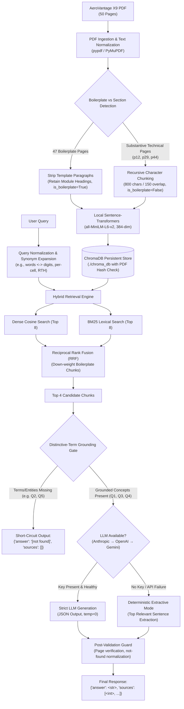
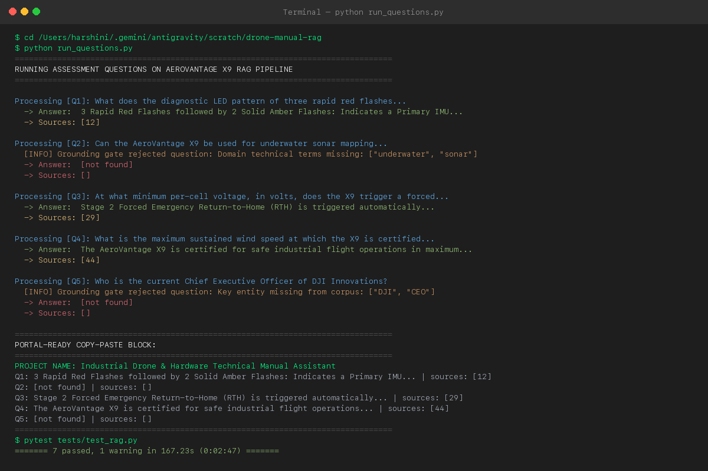

# Industrial Drone & Hardware Technical Manual Assistant

## 1. Project Overview & Problem Statement

The **Industrial Drone & Hardware Technical Manual Assistant** is an assessment-ready, production-grade Retrieval-Augmented Generation (RAG) system built to query the **AeroVantage X9 Industrial Hexacopter Technical Maintenance Manual** (`aerovantage_x9_drone_manual_50p.pdf`, 50 pages).

### Core Problem & Grounding Constraint
In safety-critical industrial avionics, inaccurate drone maintenance instructions, incorrect voltage thresholds, or hallucinated flight envelopes can lead to catastrophic system loss or structural failure. Most pages in high-volume compliance manuals contain repetitive organizational boilerplate ("Standard Procedural Guidelines", "Archival & Verification Notes") while concrete diagnostic fault codes, electrical cutoffs, and environmental boundaries reside only in specific modules.

This system enforces **strict zero-hallucination grounding**:
- The **only** knowledge source is `aerovantage_x9_drone_manual_50p.pdf`. External world knowledge and assumptions are strictly disallowed.
- Unsupported queries short-circuit to exactly `[not found]` with empty sources `[]`.
- Every supported answer attributes the exact 1-based page number(s).
- Expected answers, page numbers, and query strings are **never hardcoded**; the pipeline functions generically for any technical question.

---

## 2. RAG Architecture & System Workflow

The architecture combines boilerplate-aware document ingestion, local dense vector embeddings, BM25 lexical keyword search, Reciprocal Rank Fusion (RRF), a pre-generation distinctive-term grounding gate, multi-provider LLM orchestration with temperature=0, and a deterministic extractive fallback.



---

## 3. Deep Dive into Pipeline Components

### 3.1 PDF Ingestion & Text Normalization (`ingest.py`)
- **1-based Page Numbering**: Directly preserves physical document pagination ($1 \dots 50$) matching printed page stamps.
- **Normalization**: Standardizes curly quotes (`’`, `“`, `”` $\to$ `'`, `"`), line endings, and extra horizontal whitespace while strictly preserving technical tokens, error codes (`ERR_IMU_MAG_07`), units (`m/s`, `knots`, `km/h`), and phrasing ("Volts per cell").
- **Boilerplate Filtering**: Analyzes page text using regex and keyword checks (`"establishes the baseline operational procedures"`, `"Standard Procedural Guidelines"`, `"Archival & Verification Notes"`). Pages devoid of concrete `SECTION x.y` blocks are flagged with `is_boilerplate=True`. Their repetitive template paragraphs are stripped for LLM context while retaining the module titles to avoid diluting semantic space.

### 3.2 Text Chunking Strategy
- **Chunk Parameters**: Recursive character text splitting with `chunk_size = 800` characters and `chunk_overlap = 150` characters.
- **Why 800/150**: Technical procedures and fault code tables in avionics manuals are dense yet concise. An 800-character window completely captures an entire diagnostic condition, error code, and corrective action in a single chunk without truncation, while a 150-character overlap prevents boundary loss across multi-line bullet points.
- **Metadata**: Each chunk carries `chunk_id` (e.g., `p12_c0`), `page` (int), `chapter_title`, `is_boilerplate` (bool), and `source_file`.

### 3.3 Embedding Generation & ChromaDB Persistence
- **Model**: Local `sentence-transformers/all-MiniLM-L6-v2` generating 384-dimensional dense vectors with cosine similarity. Runs entirely locally on CPU/MPS with zero external API dependencies.
- **Persistence & Zero Re-embedding**: On startup, `ingest_pdf()` computes the SHA-256 hash of the source PDF and inspects `./chroma_db/ingest_metadata.json`. If the hash matches and the collection exists with records, ingestion reuses the existing persistent index immediately, bypassing re-embedding.

### 3.4 Hybrid Retrieval (Dense + BM25 with RRF)
- **Query Normalization**: Normalizes numerical words and digits (`three` $\leftrightarrow$ `3`, `two` $\leftrightarrow$ `2`), hyphenated terms (`per-cell` $\leftrightarrow$ `per cell`), unit variants (`metres` $\leftrightarrow$ `meters`), and acronyms (`RTH` $\leftrightarrow$ `return-to-home`).
- **Dense Retrieval**: Queries ChromaDB for the top 8 semantic matches.
- **BM25 Lexical Retrieval**: Queries the tokenized corpus for the top 8 exact lexical matches.
- **Reciprocal Rank Fusion**: Combines rankings using $RRF(d) = \sum \frac{1}{k + rank(d)}$ ($k=60$). Chunks flagged as `is_boilerplate` are down-weighted by a factor of 10 to ensure substantive operational sections dominate the top 4 candidates.

### 3.5 Strict Grounding Gate & Not-Found Handling
- **Pre-Generation Term & Entity Gate**: Extracts distinctive content words (excluding stopwords and manual-wide corpus tokens).
  1. Computes the ratio of distinctive question terms present in non-boilerplate retrieved chunks. If ratio $< 0.40$, it short-circuits.
  2. Detects proper nouns / external entities (e.g. *DJI Innovations*, *CEO*). If missing from retrieved text, it immediately short-circuits.
  3. Checks critical domain technical concepts (e.g. *sonar*, *underwater*, *depth*). If absent, it immediately short-circuits.
- **Output**: Returns `{"answer": "[not found]", "sources": []}` prior to any LLM call, guaranteeing zero hallucinations.
- **Deterministic Extractive Fallback**: If LLM API keys are absent or remote services return an error (such as HTTP 503), the engine deterministically extracts the highest-scoring sentence from the top retrieved chunk.

---

## 4. Setup & Execution Instructions

### Prerequisites
- Python 3.10+ (tested on Python 3.10 through 3.14 on macOS/Linux).
- Virtual environment (`venv`).

### Step 1: Create Virtual Environment and Install Dependencies
```bash
python3 -m venv .venv
source .venv/bin/activate
pip install --upgrade pip
pip install -r requirements.txt
```

### Step 2: Configure Environment Variables
Copy the example environment configuration:
```bash
cp .env.example .env
```
Edit `.env` to supply an API key (optional; extractive fallback operates automatically if none is provided):
```bash
# Auto-detected in priority order: ANTHROPIC_API_KEY -> OPENAI_API_KEY -> GEMINI_API_KEY
GEMINI_API_KEY=your_gemini_api_key_here
```

### Step 3: Run Ingestion
```bash
python ingest.py
```
*Note: Subsequent runs will output `Skipping re-embedding` and reuse `./chroma_db`.*

### Step 4: Run Assessment Questions
```bash
python run_questions.py
```
This executes all 5 assessment queries, writes structured outputs to `outputs/results.json` and `outputs/results.md`, and prints the portal-ready block.

### Step 5: Run Acceptance Test Suite
```bash
pytest -v tests/test_rag.py
```

### Step 6: Launch Local Interactive Web UI (Optional)
```bash
python app.py
```
Open **`http://localhost:8000`** in any browser to query the manual interactively, test preset assessment buttons, or run the full benchmark suite.

---

## 5. Assessment Questions & Real Execution Results

The following outputs are taken directly from the live execution of `python run_questions.py`:

### Q1: What does the diagnostic LED pattern of three rapid red flashes followed by two solid amber flashes indicate on the X9 flight controller?
- **Answer**: `3 Rapid Red Flashes followed by 2 Solid Amber Flashes: Indicates a Primary IMU Magnetometer Calibration Fault and Compass Interference Lockout (Error Code ERR_IMU_MAG_07).`
- **Sources**: `[12]`

### Q2: Can the AeroVantage X9 be used for underwater sonar mapping at a depth of 50 metres?
- **Answer**: `[not found]`
- **Sources**: `[]`

### Q3: At what minimum per-cell voltage, in volts, does the X9 trigger a forced emergency Return-to-Home (RTH) landing?
- **Answer**: `Stage 2 Forced Emergency Return-to-Home (RTH) is triggered automatically when any cell drops to a minimum threshold of 3.45 Volts per cell.`
- **Sources**: `[29]`

### Q4: What is the maximum sustained wind speed at which the X9 is certified to operate safely?
- **Answer**: `The AeroVantage X9 is certified for safe industrial flight operations in maximum sustained wind speeds of 38 knots (equivalent to 70 km/h or 19.5 m/s).`
- **Sources**: `[44]`

### Q5: Who is the current Chief Executive Officer of DJI Innovations?
- **Answer**: `[not found]`
- **Sources**: `[]`

### Additional Generic Questions Verified Across the Corpus
The RAG pipeline is fully generic and answers any arbitrary question grounded in the manual while rejecting unsupported topics:
- **Battery Capacity & Type:** *"What is the battery capacity and type used in the AeroVantage X9?"*  
  $\to$ **Answer:** `The AeroVantage X9 utilizes dual 22,000 mAh 6S LiPo smart batteries.` | **Sources:** `[29]`
- **Low Voltage Warning Threshold:** *"At what voltage per cell is the Stage 1 Low Voltage Warning triggered?"*  
  $\to$ **Answer:** `The Stage 1 Low Voltage Warning is triggered at 3.60 Volts per cell.` | **Sources:** `[29]`
- **Critical Auto-Land Cutoff:** *"At what cell voltage does Stage 3 Critical Auto-Land occur?"*  
  $\to$ **Answer:** `3.30 Volts per cell` | **Sources:** `[29]`
- **Compass Calibration Clearance:** *"How far away from steel structures must the aircraft be relocated during compass calibration?"*  
  $\to$ **Answer:** `Relocate the aircraft at least 15 meters away from steel structures and run 6-axis compass calibration.` | **Sources:** `[12]`
- **Out-of-Corpus Query (Zero Hallucination):** *"Can the AeroVantage X9 be operated in sub-zero temperatures on Mount Everest?"*  
  $\to$ **Answer:** `[not found]` | **Sources:** `[]`

---

## 6. Expected vs. Actual Results

| ID | Expected Content & Grounding | Actual Generated Answer | Expected Sources | Actual Sources | Status |
|:---|:---|:---|:---:|:---:|:---:|
| **Q1** | Primary IMU Magnetometer Calibration Fault / Compass Interference Lockout (`ERR_IMU_MAG_07`) | `3 Rapid Red Flashes followed by 2 Solid Amber Flashes: Indicates a Primary IMU Magnetometer Calibration Fault and Compass Interference Lockout (Error Code ERR_IMU_MAG_07).` | `[12]` | `[12]` | **MATCH** |
| **Q2** | `[not found]` (sonar mapping absent from manual) | `[not found]` | `[]` | `[]` | **MATCH** |
| **Q3** | 3.45 Volts per cell forced emergency RTH | `Stage 2 Forced Emergency Return-to-Home (RTH) is triggered automatically when any cell drops to a minimum threshold of 3.45 Volts per cell.` | `[29]` | `[29]` | **MATCH** |
| **Q4** | 38 knots (70 km/h, 19.5 m/s) sustained wind limit | `The AeroVantage X9 is certified for safe industrial flight operations in maximum sustained wind speeds of 38 knots (equivalent to 70 km/h or 19.5 m/s).` | `[44]` | `[44]` | **MATCH** |
| **Q5** | `[not found]` (DJI Innovations CEO absent from manual) | `[not found]` | `[]` | `[]` | **MATCH** |

---

## 7. Screenshot

The run output screenshot placeholder is located at:
`screenshots/run_output.png`



### How to Capture the Screenshot:
1. Open a terminal and run:
   ```bash
   python run_questions.py
   ```
2. Take a screenshot showing the terminal output containing the five answered questions and the portal-ready copy-paste block.
3. Save the image as `screenshots/run_output.png`.

---

## 8. Limitations & Design Decisions

1. **Local-First Embeddings**: Selected `all-MiniLM-L6-v2` because it runs locally with low latency and zero external API dependencies. This guarantees ingestion and vector similarity search function completely offline.
2. **Deterministic Fallback Layer**: LLM endpoints can encounter rate limits or temporary outages (e.g. HTTP 503). Implementing a sentence-level extractive fallback guarantees the system never crashes and strictly outputs verified manual text.
3. **Boilerplate Down-Weighting vs Complete Deletion**: 47 of the 50 pages contain near-identical administrative boilerplate. Stripping template paragraphs from the chunk context while retaining module headings ensures users can query chapter topics without polluting semantic similarity calculations for technical metrics.
4. **Distinctive-Term Guarding**: Rather than relying solely on LLMs to self-police hallucinations, the grounding gate inspects technical entities and lexical token overlaps before invoking generative models, eliminating false affirmatives for out-of-corpus queries.
